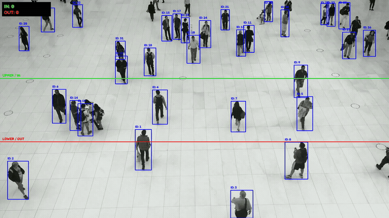
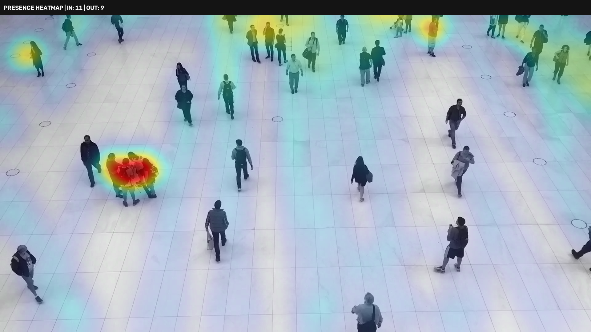

# People Flow Detection

A computer vision project that detects, tracks, and counts people crossing a
virtual line using YOLOv11 object detection, with real-time flow analysis and
heatmap visualization.

## Features

- **Person Detection** — YOLOv11 nano model for fast, accurate detection
- **Object Tracking** — Persistent ID assignment across frames
- **Line-Crossing Counter** — Counts people moving in/out across a horizontal line
- **Heatmap Generation** — Gaussian-blurred density map of foot traffic
- **Video Export** — Annotated output video with bounding boxes, IDs, and counters

## Quick Start

1. Open `people-flow-detection.ipynb` in Jupyter
2. Run all cells — the notebook downloads the sample video automatically
3. Check `output/` for the annotated video and heatmap image

## Tech Stack

- Python, OpenCV, NumPy, Matplotlib
- Ultralytics YOLOv11
- FFmpeg (via imageio-ffmpeg)

## Output

| File | Description |
|------|-------------|
| `output/people-walking-detection.mp4` | Annotated video with tracking overlays |
| `output/demo.gif` | Full-length animated preview of tracking & counting |
| `output/people-walking-heatmap.png` | Density heatmap of pedestrian traffic |

## Demo

### Detection & Line Crossing Tracking

### Heatmap

